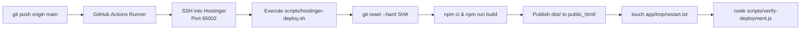

# Production Deployment & Rollback Operations Manual

**Target Host**: Hostinger Cloud Platform  
**Live Origin**: `https://test3.avinyacarefoundation.org`  
**Application Root**: `/home/u382139760/domains/test3.avinyacarefoundation.org/app`  
**Public Root**: `/home/u382139760/domains/test3.avinyacarefoundation.org/public_html`  
**Node.js Engine**: Alt-NodeJS v22 (`/opt/alt/alt-nodejs22/root/bin`)  
**Process Manager**: Phusion Passenger / LiteSpeed Web Server  

---

## 1. Automated Deployment Pipeline

The deployment process is orchestrated via GitHub Actions (`.github/workflows/deploy.yml`) over secure SSH:



### Deployment Parameters (Workflow Dispatch Inputs):
- `RUN_MIGRATIONS`: `false` by default. Set to `true` only during a deliberate release window to execute pending migrations.
- `SEED_CATALOGUE`: `false` by default. Strictly reserved for initial provisioning of brand-new databases.
- `CONFIRM_CATALOGUE_PURGE`: `false` by default. Required for irreversible historical purge operations.

---

## 2. Pre-Deployment Health Checklist

Before initiating any release to production:
1. `npm test` passes 100% (242/242 passing).
2. `npm run build` completes with 0 errors.
3. Database backup snapshot is captured:
   ```bash
   mysqldump -u <DB_USER> -p<DB_PASSWORD> <DB_NAME> > backup_$(date +%Y%m%d_%H%M%S).sql
   ```
4. Verify no uncommitted changes or secrets in Git working tree.

---

## 3. Rollback Procedures

### Scenario A: Fast Application Rollback (Code Regression)
If a software bug or visual glitch is discovered after deployment:
1. SSH into Hostinger or trigger GitHub Action for the previous stable commit SHA:
   ```bash
   cd /home/u382139760/domains/test3.avinyacarefoundation.org/app
   git reset --hard <PREVIOUS_STABLE_SHA>
   npm ci --include=dev
   npm run build
   cp dist/index.html /home/u382139760/domains/test3.avinyacarefoundation.org/public_html/
   cp -a dist/assets/. /home/u382139760/domains/test3.avinyacarefoundation.org/public_html/assets/
   touch tmp/restart.txt
   ```
2. Total execution time: < 45 seconds. Zero database data loss.

### Scenario B: Database Migration Rollback
If a database migration fails or causes SQL errors:
1. Revert last applied migration:
   ```bash
   node -e "import('./server/db.js').then(async ({ db }) => {
     await db.migrate.rollback();
     console.log('Rolled back last migration successfully');
     process.exit(0);
   });"
   ```
2. Re-trigger Passenger restart:
   ```bash
   touch tmp/restart.txt
   ```

### Scenario C: Emergency Database Dump Restoration
In case of table corruption or accidental schema dropping:
1. Stop traffic to avoid inconsistent state:
   ```bash
   touch tmp/restart.txt
   ```
2. Restore MySQL snapshot:
   ```bash
   mysql -u <DB_USER> -p<DB_PASSWORD> <DB_NAME> < backup_pre_migration_YYYYMMDD_HHMMSS.sql
   ```
3. Verify restored table counts:
   ```sql
   SELECT 'jewelries' AS tbl, count(*) FROM jewelries
   UNION ALL
   SELECT 'kurtas', count(*) FROM kurtas
   UNION ALL
   SELECT 'coins', count(*) FROM coins;
   ```
4. Restart Passenger:
   ```bash
   touch tmp/restart.txt
   ```

---

## 4. Post-Deployment Verification Gate

Run the automated verification script against the live site:
```bash
node scripts/verify-deployment.js https://test3.avinyacarefoundation.org --allow-preview
```
The script validates:
- HTTP 200 on `/`, `/admin`, `/collections/all`, `/kurtas`, `/coins`.
- Client assets bundle returns `text/javascript`, not fallback HTML.
- Config endpoint returns valid merchant settings.
- Catalogue APIs (`/api/products`, `/api/coins`, `/api/kurtas`, `/api/jewelry`) return valid arrays.
