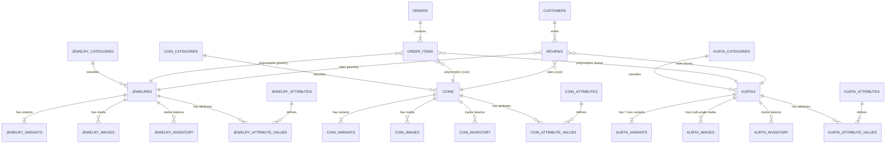

# Database Restructuring: Jewelry, Coin & Kurta Modules

This document records the Migration 025 design and verification at the time of rollout. See the [current project architecture](PROJECT_ARCHITECTURE.md) for the relationship between dedicated and legacy catalogue paths.

## 1. Executive Summary & Architecture Evolution

Previously, the application utilized a generic, monolithic `products` table designed primarily around gold-linked jewelry pricing attributes. As the business expanded to offer three distinct luxury domains:
1. **Fine Jewelry** (Gold-linked pricing, making charges, gemstone/diamond caratage, purity breakdown)
2. **Bullion & Coins** (Metal-linked Gold & Silver, mint certification, denomination, year of issue, assay hallmarks)
3. **Apparel & Lucknowi Chikankari Kurtas** (Fixed pricing, multi-color collections, 7 standard sizing variants: XS to XXXL, fabric & pattern attributes)

The single-table pattern introduced architectural compromises, null-polluted schemas, and tight coupling across inventory, cart, pricing, and administrative workflows.

Under the new architecture implemented in migration `025_independent_modules_jewelry_coin_kurta.js`, the generic storage model has been completely replaced with three independent, fully decoupled database structures. Each domain maintains dedicated category, parent item, variant, image, attribute, and inventory transaction tables, bound together through type-aware relationships in shared subsystems (orders, cart, reviews, payments).

---

## 2. Entity-Relationship Architecture

---

## 3. Dedicated Database Schemas

### 3.1 Jewelry Module Schemas

| Table | Primary Responsibility | Key Fields & Constraints |
| :--- | :--- | :--- |
| `jewelry_categories` | Categorization (Rings, Necklaces, etc.) | `id`, `slug` (UNIQUE), `name`, `status`, `sort_order` |
| `jewelries` | Master parent jewelry pieces | `id`, `sku` (UNIQUE), `product_code`, `slug` (UNIQUE), `name`, `metal`, `purity`, `gross_weight_g`, `net_weight_g`, `making_charges`, `making_percent`, `gst`, `stone_details`, `diamond_details`, `gemstone_details`, `pricing_mode`, `fixed_price`, `stock`, `status`, `image`, `seo_title`, `meta_description` |
| `jewelry_variants` | Size, finish, and metal purity variants | `id`, `jewelry_id` (FK -> `jewelries.id` ON DELETE CASCADE), `sku` (UNIQUE), `size`, `finish`, `metal`, `purity`, `price`, `fixed_price`, `stock`, `status` |
| `jewelry_images` | Multi-angle studio media | `id`, `jewelry_id` (FK -> `jewelries.id` ON DELETE CASCADE), `role` (`hero`, `front`, `right`, `left`, `back`, `model`, `detail`), `url`, `alt_text`, `sort_order` |
| `jewelry_attributes` | EAV attribute definition | `id`, `code` (UNIQUE), `name`, `type` |
| `jewelry_attribute_values`| EAV concrete piece attribute values | `id`, `jewelry_id` (FK), `attribute_id` (FK), `value` |
| `jewelry_inventory` | Immutable double-entry inventory ledger | `id`, `jewelry_id` (FK), `variant_id` (FK), `sku`, `quantity_change`, `balance_after`, `reason`, `reference_id`, `created_at` |

### 3.2 Coin & Bullion Module Schemas

| Table | Primary Responsibility | Key Fields & Constraints |
| :--- | :--- | :--- |
| `coin_categories` | Mint categories (Gold, Silver, Devotional) | `id`, `slug` (UNIQUE), `name`, `status`, `sort_order` |
| `coins` | Master bullion coins and minted bars | `id`, `sku` (UNIQUE), `slug` (UNIQUE), `name`, `metal` (`Gold`, `Silver`), `coin_type`, `purity` (`24K`, `999`, `925`), `weight_g`, `dimension`, `denomination`, `mint`, `collection`, `edition`, `year_of_issue`, `certification`, `making_charge`, `pricing_mode`, `fixed_price`, `stock`, `description`, `image`, `status`, `image_kind`, `seo_title`, `meta_description` |
| `coin_variants` | Coin weight and finish variants | `id`, `coin_id` (FK -> `coins.id` ON DELETE CASCADE), `sku` (UNIQUE), `name`, `metal`, `purity`, `weight_g`, `dimension`, `price`, `fixed_price`, `stock`, `status` |
| `coin_images` | Mint face & edge photography | `id`, `coin_id` (FK -> `coins.id` ON DELETE CASCADE), `role` (`hero`, `front`, `left`, `right`, `back`, `model`, `detail`), `url`, `alt_text`, `sort_order` |
| `coin_attributes` | Attribute definitions | `id`, `code` (UNIQUE), `name`, `type` |
| `coin_attribute_values` | Concrete bullion attribute values | `id`, `coin_id` (FK), `attribute_id` (FK), `value` |
| `coin_inventory` | Immutable stock audit ledger | `id`, `coin_id` (FK), `variant_id` (FK), `sku`, `quantity_change`, `balance_after`, `reason`, `reference_id`, `created_at` |

### 3.3 Kurta Module Schemas

| Table | Primary Responsibility | Key Fields & Constraints |
| :--- | :--- | :--- |
| `kurta_categories` | Apparel collections (Chikankari, Festive) | `id`, `slug` (UNIQUE), `name`, `status`, `sort_order` |
| `kurtas` | Master style/silhouette parent pieces | `id`, `product_code` (UNIQUE), `sku` (UNIQUE), `slug` (UNIQUE), `name`, `category`, `description`, `fabric`, `pattern`, `fit`, `sleeve_type`, `neck_type`, `occasion`, `gender`, `material`, `price`, `sale_price`, `stock`, `status`, `supplier`, `image`, `seo_title`, `meta_description` |
| `kurta_variants` | 7-Size (`XS (34)` to `XXXL (46)`) & color variants | `id`, `kurta_id` (FK -> `kurtas.id` ON DELETE CASCADE), `product_code`, `sku` (UNIQUE), `slug` (UNIQUE), `size`, `color`, `color_code`, `hex_color`, `finish`, `price`, `fixed_price`, `stock`, `image`, `status` |
| `kurta_images` | Multi-angle garment photography | `id`, `kurta_id` (FK -> `kurtas.id` ON DELETE CASCADE), `product_code`, `sku`, `color`, `role` (`hero`, `front`, `right`, `left`, `back`, `model`, `detail`), `url`, `alt_text`, `sort_order` |
| `kurta_attributes` | Style attribute definitions | `id`, `code` (UNIQUE), `name`, `type` |
| `kurta_attribute_values` | Garment attribute values | `id`, `kurta_id` (FK), `attribute_id` (FK), `value` |
| `kurta_inventory` | Per-size inventory transaction audit | `id`, `kurta_id` (FK), `variant_id` (FK), `sku`, `quantity_change`, `balance_after`, `reason`, `reference_id`, `created_at` |

---

## 4. Polymorphic Integration for Shared Subsystems

To maintain complete normalization without forcing disparate domains into a single table, shared subsystems use explicit polymorphic columns:

### 4.1 Order Items (`order_items`)
- Added `item_type`: `'jewelry' | 'coin' | 'kurta'`.
- Added `item_id`: References the respective master ID in `jewelries.id`, `coins.id`, or `kurtas.id`.
- `snapshot`: Stores immutable JSON snapshot of unit price, item name, variant attributes (size, weight, fabric), making charges, and discounts at the time of purchase.

### 4.2 Customer Reviews (`reviews`)
- Added `item_type`: `'jewelry' | 'coin' | 'kurta'`.
- Added `jewelry_id`: Foreign key reference to `jewelries.id`.
- Added `coin_id`: Foreign key reference to `coins.id`.
- Added `kurta_id`: Foreign key reference to `kurtas.id`.
- Maintained legacy `product_id` for backward compatibility with existing storefront queries.

---

## 5. Foreign Key & Cascading Delete Guarantees

All child tables (`*_variants`, `*_images`, `*_attribute_values`, `*_inventory`) specify `ON DELETE CASCADE` referencing their respective parent master table (`jewelries`, `coins`, `kurtas`). SQLite enforces these constraints via `PRAGMA foreign_keys = ON`.
Deleting a master item cleanly cleans up variants, media, and inventory audit rows without leaving orphaned records.
