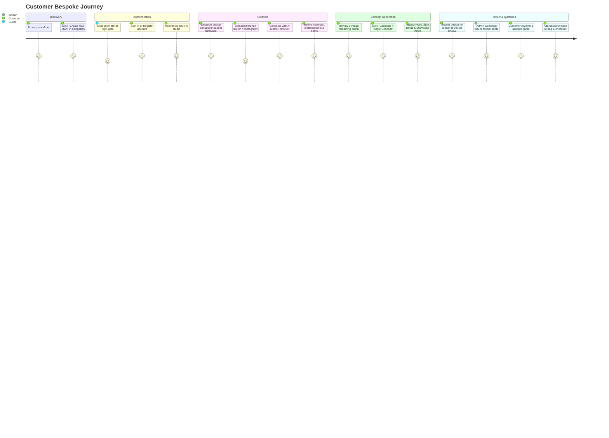

# VEYORA JEWELS — AI Create Your Own (CYO) User Flow & Journey

## 1. Journey Overview

The Veyora Create Your Own (CYO) experience guides registered clients through an intimate, high-luxury bespoke jewellery creation journey.

---

## 2. Step-by-Step User Journey

### Step 1: Navigation Entry
- Customer spots the dedicated **Create Your Own** link with a gold sparkle icon in the primary navbar or mobile menu.
- URL: `https://veyora.com/create-your-own`

### Step 2: Compulsory Authentication Gate
- If the visitor is a guest, the studio displays a welcome card explaining the bespoke experience, member quotas, and workshop guarantees.
- Clicking "Sign In" stores the return intent in session storage (`redirect_after_login = '/create-your-own'`).
- Upon successful authentication, the customer is immediately returned to `/create-your-own`.

### Step 3: Natural Language Imagination
- Customer expresses their concept in free-form language:
  > *"Create a traditional Kundan bridal choker in 22K antique gold with Zambian emerald drops and Basra pearls for a winter wedding."*
- The AI Design Consultant extracts key attributes:
  - **Category:** Necklace / Choker
  - **Metal:** 22K Gold
  - **Craftsmanship:** Kundan
  - **Finish:** Antique Gold Finish
  - **Gemstones:** Zambian Emerald & Basra Pearls
  - **Motifs:** Artisanal Floral & Royal Heirlooms

### Step 4: Multi-Turn Conversational Refinement
- The AI Assistant replies warmly, validating the customer’s aesthetic choices and offering advice on scale, neckline fit, and stone security.
- Customer can upload reference sketches, family heirloom photos, or screenshots.
- Complete-the-set recommendations suggest companion pieces (e.g., matching Kundan chandbalis and cocktail rings).

### Step 5: Photorealistic Multi-Angle Concept Generation
- Customer observes their real-time quota badge (e.g. `✦ 3 of 3 AI concept generations remaining`).
- Customer triggers generation:
  - Consumes 1 quota credit atomically.
  - Generates 4 simultaneous 1024x1024 WebP views:
    1. **Front View:** Centered studio catalogue shot.
    2. **Side Profile:** 45-degree angle displaying relief depth and setting thickness.
    3. **Close-Up Detail:** 2.2x macro zoom focusing on gemstone prongs, facet luster, and Kundan foil work.
    4. **Velvet Showcase:** Editorial perspective draped on luxury velvet.
- Customer toggles tabs to inspect every angle or clicks "Inspect Detail" for a high-resolution zoom overlay.

### Step 6: Technical Feasibility & Quotation Request
- The studio calculates a live structural feasibility score (98%), estimated gross/net weight (~22.5g), and engineering considerations.
- Customer clicks **Request Artisan Quotation**.
- Status updates to `Submitted for Review`.

### Step 7: Artisan Quotation Issuance & Customer Acceptance
- Workshop artisans inspect the design in `/admin/custom-designs`, calculate precise metal weights, gem costs, and making charges, and issue a formal quote (valid for 7 days).
- Customer receives the quote directly in their studio view.
- Customer reviews the breakdown and clicks **Accept Quotation**.
- Status transitions to `Quotation Accepted`.

### Step 8: Bag Injection & Checkout
- With the quotation accepted, an **Add to Bag & Checkout** button appears.
- Clicking injects the bespoke order item into the customer's bag (`CYO-QUOTE-<id>`).
- Customer completes Cash on Delivery checkout with standard address and OTP validation.
