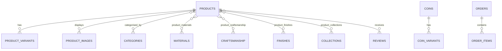

# Catalogue Database Architecture & Relational Schema

## 1. Relational Architecture Philosophy
Veyora Jewels utilizes a 3NF normalized relational schema powered by SQLite / Knex.js. Products, categories, materials, craftsmanship techniques, surface finishes, and curated collections are maintained as distinct first-class entities with dedicated junction tables to prevent denormalized comma-separated antipatterns.

---

## 2. Core Tables Specification

### 2.1 `products`
The master record for jewellery, ethnic kurtas, and apparel styles.
- `id` (INTEGER PRIMARY KEY)
- `product_code` (TEXT UNIQUE NOT NULL)
- `slug` (TEXT UNIQUE NOT NULL)
- `name` (TEXT NOT NULL)
- `category` (TEXT NOT NULL)
- `metal` (TEXT NULL) — Gold, Silver, Rose Gold, Platinum, Cotton, Silk
- `purity` (TEXT NULL) — 18K, 22K, 24K, 925, etc.
- `pricing_mode` (TEXT NOT NULL) — `FIXED` or `GOLD_LINKED`
- `base_price` / `price` (DECIMAL)
- `stock` (INTEGER DEFAULT 0)
- `is_kurta` (BOOLEAN DEFAULT 0)
- `status` (TEXT DEFAULT 'published')
- `created_at` / `updated_at` (DATETIME)

### 2.2 `materials` & `product_materials`
First-class classification of precious metals, gemstones, pearls, and premium fabrics.
- `materials`: `id`, `slug`, `name`, `description`, `thumbnail`, `status`, `sort_order`, `seo_title`, `meta_description`.
- `product_materials`: `product_id` (FK -> products.id), `material_id` (FK -> materials.id), `is_primary` (BOOLEAN).

### 2.3 `craftsmanship` & `product_craftsmanship`
Artisanal techniques and heritage Indian jewellery-making traditions.
- `craftsmanship`: `id`, `slug`, `name`, `origin_region`, `technique_type`, `description`, `thumbnail`, `status`, `sort_order`, `seo_title`, `meta_description`.
- `product_craftsmanship`: `product_id` (FK -> products.id), `craftsmanship_id` (FK -> craftsmanship.id).

### 2.4 `finishes` & `product_finishes`
Surface treatments, patinas, and electroplating finishes.
- `finishes`: `id`, `slug`, `name`, `finish_family`, `description`, `status`, `sort_order`.
- `product_finishes`: `product_id` (FK -> products.id), `finish_id` (FK -> finishes.id).

### 2.5 `collections` & `product_collections`
Marketing, aesthetic, and thematic curations (e.g. Gold Collection, Silver Collection, Royal Bridal).
- `collections`: `id`, `slug`, `name`, `banner_image`, `description`, `status`, `sort_order`, `seo_title`, `meta_description`.
- `product_collections`: `product_id` (FK -> products.id), `collection_id` (FK -> collections.id).

### 2.6 `product_images`
Angle-tagged gallery assets supporting high-resolution multi-view zoom.
- `id` (INTEGER PRIMARY KEY)
- `product_id` (INTEGER NOT NULL FK -> products.id)
- `variant_sku` (TEXT NULL)
- `url` (TEXT NOT NULL)
- `role` (TEXT NOT NULL) — `front`, `right`, `left`, `back`, `detail`, `modal`
- `color_code` (TEXT NULL)
- `sort_order` (INTEGER DEFAULT 0)

### 2.7 `coins`
Dedicated bullion and numismatic store.
- `id` (INTEGER PRIMARY KEY)
- `sku` (TEXT UNIQUE NOT NULL)
- `name` (TEXT NOT NULL)
- `metal` (TEXT NOT NULL) — `gold` or `silver`
- `purity` (TEXT NOT NULL) — `24K (999)` or `999 Fine Silver`
- `weight_g` (DECIMAL NOT NULL)
- `pricing_mode` (TEXT DEFAULT 'METAL_LINKED')
- `making_charge` (DECIMAL DEFAULT 0)
- `dimension` (TEXT NULL)
- `packaging` (TEXT NULL)
- `image` / `thumbnail` (TEXT NOT NULL)

---

## 3. Database Migration History
- `001_initial_schema.js` — Core product, order, customer tables.
- `010_categories_and_discounts.js` — Categories and festive discounts.
- `015_coins_bullion_system.js` — Bullion coins and live metal pricing.
- `018_customer_reviews.js` — Verified reviews, moderation, and image attachments.
- `020_kurta_apparel_system.js` — Apparel sizes (XS-XXXL), colourways, and multi-angle roles.
- `021_admin_audit_and_indexes.js` — Indexing for high-performance search and active states.
- `022_materials_craftsmanship_collections_and_recommendations.js` — Independent relational tables for Materials, Craftsmanship, Finishes, Collections, and AI Recommendation weight configs.
